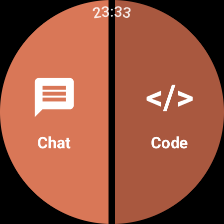
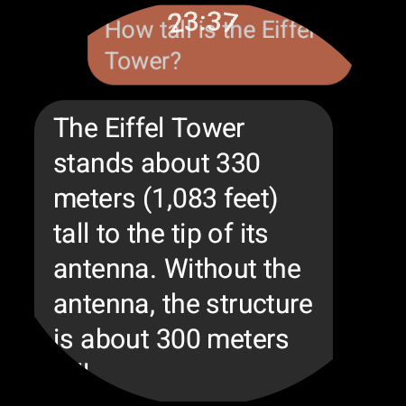
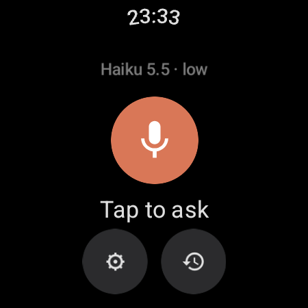
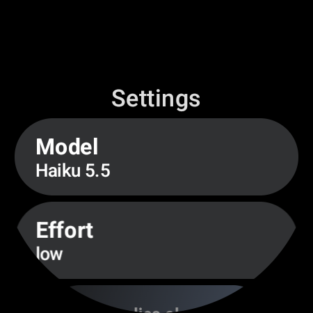
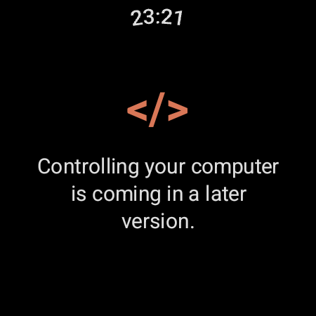

<div align="center">

# Wristle

**A voice-first Claude assistant that lives on your wrist.**

<table>
  <tr>
    <td align="center"></td>
    <td align="center"></td>
    <td align="center"></td>
  </tr>
  <tr>
    <td align="center"><sub><i>Start screen</i></sub></td>
    <td align="center"><sub><i>Ask, read, listen</i></sub></td>
    <td align="center"><sub><i>New chat</i></sub></td>
  </tr>
  <tr>
    <td align="center"></td>
    <td align="center"></td>
    <td></td>
  </tr>
  <tr>
    <td align="center"><sub><i>Settings</i></sub></td>
    <td align="center"><sub><i>Code (coming in phase 2)</i></sub></td>
    <td></td>
  </tr>
</table>

Press and hold the Home key, ask a question out loud, and watch the answer
stream in while it is read back to you. The watch talks straight to the
Claude API over its own Wi-Fi or LTE: no phone, no computer, no server.

[What it does](#what-it-does) · [Compatibility](#compatibility) · [How it works](#how-it-works) · [Quick start](#quick-start) · [Launching](#launching-wristle) · [Roadmap](docs/phase-1-plan.md)

</div>

---

## ⚠️ Project status — read this first

This is a **personal hobby project**. It runs every day on my Galaxy Watch 4.
It is public because someone else might enjoy it, not because it is
production-grade.

- **Unofficial.** Not affiliated with, sponsored or endorsed by Anthropic.
  "Claude" is a trademark of Anthropic, PBC, and is used here only to say
  which API the app talks to.
- **You pay for your own usage.** The app uses your own Claude API key
  (pay-as-you-go). Set a spending limit in the Claude Console.
- **The API key lives on the watch,** encrypted with a key from the Android
  Keystore. Anyone with your unlocked watch and developer access could try
  to get at it.
- **Sideload only.** There is no Play Store build; you install it with `adb`.
- **Expect breakage.** Wear OS, One UI Watch and the APIs underneath all move.

---

## What it does

- 🎙️ **Voice first.** Opens straight into listening and uses the watch's own
  speech recognizer (Google's on the Galaxy Watch 4, Dutch works fine).
- 🔊 **Reads replies aloud while they stream,** sentence by sentence. Falls
  back to Google's voice when the default engine can't speak your language.
- 🌐 **Web search** through the Claude API's server-side tool, for weather,
  news, prices and anything recent.
- 🧠 **Pick your model and effort**: Opus 5.5, Sonnet 5.5 or Haiku 5.5, effort
  low to max. Toggle between short (1–3 sentences) and longer replies.
- 🕘 **Chat history.** Your last 20 chats are kept on the watch; reopen one
  and carry on.
- ⚡ **Three ways in**: press and hold the Home key (Wristle as digital
  assistant), a one-tap **tile**, or the app list.
- 🟧 **Two half moons.** The start screen splits into *Chat* and *Code*. Code
  is where controlling your computer from the watch will live (phase 2).
- 🔒 **No accounts, no cloud of its own, no analytics.** The only outbound
  traffic is the watch talking to the Claude API with your key.

---

## Compatibility

| | |
|---|---|
| **Tested** | Samsung Galaxy Watch 4 (SM-R870), One UI Watch 8, Wear OS 6 / Android 16 |
| **Should work** | Any watch on **Wear OS 3 or newer** (`minSdk` 30): Galaxy Watch 4, 5, 6, 7 and Ultra; Pixel Watch 1, 2 and 3; recent TicWatch and other Wear OS 3+ watches. Untested. |
| **Won't work** | Wear OS 2 and older, Tizen-based Galaxy watches (Watch 3 and earlier), Apple Watch |

What a watch needs:

- **Its own internet connection** (Wi-Fi or LTE) while you ask a question.
- **A speech recognizer** that handles `RecognizerIntent` (Google's ships with
  most Wear OS 3+ watches) and a **text-to-speech engine**.
- **A round screen** looks best; square screens are untested.

Platform notes: the *Home key press and hold* setup below is specific to
Samsung's One UI Watch. On other watches, set Wristle as the digital
assistant and use whatever button your watch maps to the assistant, or just
use the tile.

---

## How it works

```
┌──────────────────┐   voice   ┌───────────────────────────────┐   HTTPS + SSE   ┌──────────────────┐
│ Watch recognizer │ ────────▶ │  Wristle (Wear OS app)        │ ─────────────▶ │  Claude API      │
│ (Google)         │   text    │  speech/  → chat/ → data/     │ ◀───────────── │  /v1/messages    │
└──────────────────┘           │  ChatBackend: ClaudeApiBackend│   streamed     │  + web search    │
                               └───────────────┬───────────────┘   reply        └──────────────────┘
                                               │ sentence by sentence
                                               ▼
                                     ┌──────────────────┐
                                     │ Text-to-speech   │
                                     └──────────────────┘
```

- **`speech/`** starts the watch's recognizer and reads replies aloud.
- **`chat/`** holds the `ChatBackend` interface. `ClaudeApiBackend` streams
  from the Claude API with the Anthropic Java SDK. Phase 2 adds a second
  backend that talks to a bridge on your computer, without touching UI or
  speech code.
- **`data/`** keeps chat state, history and settings; the API key is
  encrypted with an Android Keystore key.
- **`ui/`** is Compose for Wear OS; **`tile/`** is the one-tap tile;
  **`assist/`** lets the watch use Wristle as its digital assistant.

---

## Quick start

You need Android Studio (for the Android SDK and `adb`), JDK 17+ and a
Claude API key from [platform.claude.com](https://platform.claude.com).

**1. Configure.** Create `local.properties` in the project root (it is
git-ignored):

```properties
sdk.dir=C\:/Users/<you>/AppData/Local/Android/Sdk
claude.apiKey=sk-ant-...
```

The key is never compiled into the APK; it is sent to the watch after install.

**2. Build.**

```bash
./gradlew :app:assembleRelease
```

Use the release build on the watch: the debug build is noticeably slower and
uses more battery. Release builds are signed with `keystore.properties` if
present (see `keystore.properties.example`), otherwise with the debug key.

**3. Connect the watch.**

1. On the watch, enable developer options. On a Galaxy Watch: **Settings →
   About watch → Software → tap "Software version"** a few times. On other
   Wear OS watches it is **Build number**, tapped 7 times.
2. **Developer options** → enable **ADB debugging** and **Debug over Wi-Fi**
   (or **Wireless debugging**) → **Pair new device**.
3. On your computer, on the same Wi-Fi:

   ```bash
   adb pair <ip>:<pairing-port>
   adb connect <ip>:<debug-port>
   adb install -r app/build/outputs/apk/release/app-release.apk
   ```

   The pairing port and the debug port differ. If `adb pair` fails with
   `protocol fault`, you probably used the debug port; `adb mdns services`
   lists both.

**4. Send your API key** (once, and again after changing it or clearing app
data):

- Windows (PowerShell): `.\setup-key.ps1`
- macOS / Linux / Git Bash: `./setup-key.sh`

You can also type the key on the watch (Settings → Claude API key), but it is
long.

---

## Launching Wristle

**Home key, press and hold** (verified on One UI Watch 8):

1. **Settings → Apps → Default apps → Digital assistant app → Wristle**.
2. **Settings → Advanced features → Customize keys → Home key → Press and
   hold →** the digital assistant option.

Press and hold the Home key: Wristle opens and starts listening. Speech
recognition in other apps keeps working.

**Tile:** swipe left from the watch face to the end, tap **+ Add tile** and
choose **Wristle**. Its mic button opens straight into listening.

**App list:** opens the start screen with *Chat* and *Code*.

---

## Development

```bash
./gradlew :app:testDebugUnitTest   # unit tests
./gradlew :app:ktlintCheck         # style (ktlintFormat to fix)
./gradlew :app:lintRelease         # Android lint, warnings are errors
./gradlew :app:assembleRelease     # APK for the watch
```

The roadmap and milestone status are in [docs/phase-1-plan.md](docs/phase-1-plan.md).
Agent instructions for AI coding tools are in [AGENT.md](AGENT.md).

## License

MIT, see [LICENSE](LICENSE).
